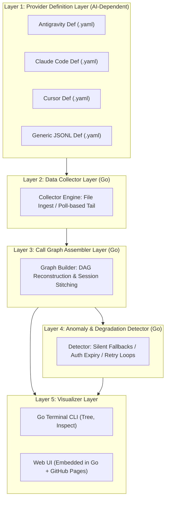

# AgentLens: Functional Specification

> **Language**: [English](SPECIFICATION.md) | [日本語](../ja/SPECIFICATION.md)

---

## 1. Overview & Problem Statement

### 1.1 The Challenge
Modern Generative AI systems operating in **autonomous / auto mode** orchestrate multi-step workflows by dynamically invoking specialized **SKILLs**, **MCP (Model Context Protocol) servers**, subagents, and internal tools.

However, visibility into what is *actually* executing behind the scenes is often opaque:
- **Silent Degradation & Fallbacks**: If an external MCP server's credentials expire (e.g., HTTP 401/403 or OAuth expiration), or a skill fails, the AI frequently attempts silent workarounds without user alert. For example, instead of directly invoking an authorized `github_mcp.create_issue` tool, the agent may silently pivot to executing shell commands (`gh issue create` or `curl`) or secondary tools, which may lack necessary context, fail midway, or yield degraded output.
- **Unintended Inefficiencies**: Users cannot readily determine whether the AI used the intended specialized tool, wasted turns on retrying failed tool invocations, or took a suboptimal detour.
- **Black-box Multi-Agent Execution**: When subagents are spawned, nested call hierarchies and tool-sharing behaviors become difficult to inspect and verify.

### 1.2 The Goal
**AgentLens** provides observability and call graph visualization for Generative AI skill and tool executions. It reconstructs execution histories as an inspectable **Call Graph (DAG)**, identifies runtime anomalies and silent fallbacks, and presents actionable insights via both a **Terminal CLI** and a **Web UI Dashboard**.

### 1.3 Environment Independence Principles
To avoid environmental friction (e.g. Python version mismatches, virtual environment conflicts, or requiring Node.js/npm on the user's machine):
1. **Single Standalone Binary in Go**: Distributed as a single binary with **zero runtime requirements** (no Python or Node.js required for the end user).
2. **Pre-Built Embedded Web UI**: The Web UI assets are bundled directly into the Go binary using `//go:embed`. Running `agentlens ui` serves the application locally offline with zero setup.
3. **Free GitHub Pages Hosting**: The same Web UI (a single `web/index.html`, no build step) is hosted at `https://tsbkw.github.io/agentlens` for free via GitHub Pages, enabling zero-install, privacy-first client-side trace inspection via drag-and-drop.

---

## 2. Core Architectural Principles

To ensure AgentLens remains future-proof and independent of specific AI vendors, it enforces a strict **5-Layer Separation of Concerns**:

### Principle: Strict Provider Isolation
**Only Layer 1 (Provider Definitions) contains knowledge of specific Generative AI systems or trace formats.**
Layers 2 through 5 operate entirely on normalized internal data models (`CallNode`, `CallEdge`, `ExecutionTurn`, `AnomalyRecord`, assembled into a `graph.Graph`). Adding support for a new AI framework (e.g., Cursor, Roo Code, LangChain) requires only a declarative configuration file, with zero modifications to the core Go engine.

---

## 3. Detailed Component Specifications

### 3.1 Layer 1: Provider Definition Layer
Declarative YAML/JSON files adhering to [`provider_definition.schema.json`](../../schemas/provider_definition.schema.json).

- **Source Configuration**: `source.type: file` with `source.paths`, a list of glob patterns (`~` expands to the home directory), and optionally `source.child_traces` describing where a session's subagent trace files and their metadata sidecars live. Files are the only source kind implemented; the schema reserves other names (`command`, `otel_collector`) for later.
- **Extraction Rules**:
  - `session`: Rule to determine the conversation or session ID.
  - `events`: Filter criteria to locate tool invocations (one event per call, or a list of calls inside one event).
  - `fields`: Field mappings for timestamp, call ID, parent caller, tool name, MCP server name, parameters, result, status, and execution duration.
  - `results`: How tool results are matched back to their calls (by call ID or by step order), including which results mean the call was denied.
  - `scopes`: Which calls open a Skill or Subagent scope, so later calls are attributed to it.
  - `auxiliary_tools`: Bookkeeping tools (tool discovery, task tracking) that never take part in fallback or retry detection.
- **Anomaly Heuristics**: Provider-specific regex patterns for auth expiration and known fallback pairs.

### 3.2 Layer 2: Data Collector Layer (Go)
- Ingests raw events according to the active provider definition.
- Supports both **historical analysis** (reading existing logs/transcripts) and **live tailing** (`agentlens watch` polls the trace file, and its subagent trace files, every 500 ms).
- Normalizes raw trace entries into standardized event structures: `RawTraceEvent`.

### 3.3 Layer 3: Call Graph Assembler Layer (Go)
- Transforms normalized events into a Directed Acyclic Graph (DAG).
- **Node Taxonomy** (`CallNodeType`):
  - `user_turn`: User prompt and intent boundary.
  - `agent`: The primary agent.
  - `subagent`: A spawned subagent.
  - `skill`: Invocation of high-level SKILL logic.
  - `mcp_tool`: Invocation of an external MCP tool, tagged with `mcp_server`.
  - `system_tool`: Native/builtin tools (e.g., shell, file read/write).
- **Edge Taxonomy** (`CallEdgeType`):
  - `calls`: Direct parent-to-child invocation.
  - `spawns`: Agent spawning a subagent.
  - `fallback_to`: An execution failure transitioning to an alternative tool attempt.
  - `retries`: Re-attempting the same tool after failure.
- Computes execution metrics (`GraphMetrics`): node and edge counts by type, failed and denied counts, the maximum call depth and the summed duration of tool calls. Token consumption is not recorded.

### 3.4 Layer 4: Anomaly & Degradation Detector (Go)
Detects execution anomalies and alerts the developer:
1. **Silent Fallback Detection**:
   - Detects when an intended tool (e.g., MCP tool) fails or returns an auth error, followed immediately by an alternative tool (e.g., shell command or proxy tool) aimed at achieving the same objective.
2. **Credential & Authentication Expiration**:
   - Identifies HTTP 401, 403, "token expired", or OAuth refresh failures within tool execution responses.
3. **Retry Loops & Thrashing**:
   - Flags 3 or more consecutive failures of the same tool by the same actor, reported once per streak.

Each silent fallback carries a `confidence` (`high` when the substitute reaches the same public service or reuses identifiers of the failed call, `low` when only the order of calls suggests it; see ARCHITECTURE). Detection of indirect proxy routing and of latency spikes is planned (ROADMAP) and not implemented.

### 3.5 Layer 5: Visualizers

#### 3.5.1 CLI Visualizer (`agentlens`)
- **`agentlens list`**: List recorded sessions and detected providers.
- **`agentlens graph <session-id | file>`**: Render the Caller ➔ Callee call graph in the terminal with colored status indicators (green = success, red = error, yellow = fallback alert), a summary line and the list of anomalies.
- **`agentlens trace <session-id | file>`**: Render the turn-by-turn execution tree with status, duration and anomaly badges.
- **`agentlens inspect <call-id> [session-id]`**: Display full details, arguments, outputs, and anomaly diagnostics for a specific node. Without a session, every discovered session is searched.
- **`agentlens watch [session-id]`**: Live terminal monitor tailing an active session (the most recent one by default) and its subagents.
- **`agentlens report`**: Aggregates calls and anomalies of all sessions over a period (`--since`, `--until`, `--project`, `--top`, `--json`), ranked by MCP server, tool and session. It also follows every Skill and MCP server across those sessions (`tool_health`) and lists the **dormant** ones: not working as of their last use, with the reason (server fails to connect, waiting for sign-in, auth failed and never fixed, denied, replaced by a substitute, failing), how long they have been silent and their last error. Skills and servers that were offered but never called are named separately.
- **`agentlens why <name>`**: Explains why a Skill or MCP server is not being used (`--since`, default 30 days, `--until`, `--project`, `--json`, `--prompt`): its outcome in every session of the period (offered, failed to connect, waiting for sign-in, called with how many successes, failures and denials, what it fell back to), the other tools that reached the same public service instead, a diagnosis with evidence (the dormancy reasons above, plus *a substitute is preferred*, *no task needed it*, *healthy* and *not found*), a recommendation, and a ready-to-paste prompt asking Claude Code on the same machine to find the cause (configuration, credentials, permissions, descriptions) without printing secrets. The same analysis is served at `GET /api/why?tool=<name>`.
- `--provider <id | file.yaml>` selects the trace format (auto-detected by default). Colors follow `NO_COLOR` / `FORCE_COLOR` and are off when stdout is not a terminal.

#### 3.5.2 Web UI Dashboard (Embedded & GitHub Pages)
- **Local Embedded Server**: Running `agentlens ui` (`--port <n>`, default 8000) serves the embedded page at `http://localhost:8000`. On top of drag and drop, the page shows a local sessions dashboard. It filters by period and project, reports the same counts as `agentlens report` (`GET /api/report`) and opens a session's call graph from its raw trace files (`GET /api/sessions/<id>/files`). Those files are analyzed in the browser just like dropped ones. The dashboard also lists the dormant Skills and MCP servers of the period with a **Why?** button (also on each MCP server row) that opens the `agentlens why` analysis in a panel: diagnosis, evidence, recent sessions (clickable), substitutes, recommendation, and the prompt for Claude Code with a copy button. The server listens on `127.0.0.1` only and rejects requests whose `Host` header is not `localhost` or a loopback IP, because its API returns full session transcripts. Starting `agentlens ui` while another one holds the port stops that instance and takes the port over: the new process checks `GET /api/instance` reports `"app": "agentlens"`, sends `POST /api/shutdown` with the `X-Agentlens-Shutdown` header (a custom header, so a web page cannot trigger it), waits for the port and binds. A port held by any other program is left alone and the command fails.
- **Free GitHub Pages Hosting**: Statically hosted at `https://tsbkw.github.io/agentlens` with client-side drag-and-drop log visualization.
- **Caller ➔ Callee Graph**: One card per caller (agent, Skill or Subagent scope) listing each callee with its call, success and failure counts, nested scopes, and a fallback row where a failed call was substituted.
- **Turn Execution Trace**: The calls of each user turn in order, with status, type, MCP server, duration and anomaly badges.
- **Anomaly Banner & Inspector Drawer**: Alert cards detailing detected silent fallbacks, auth failures and recommendations; a drawer with a node's arguments, output and anomalies. Clicking a tool row with failures defaults to the failed invocation, and an interactive invocations switcher allows toggling between all attempts in one click with Status and Type filtering.
- **Failure Diagnosis & Actionable Fixes**: Intelligent root cause extraction that strips framework boilerplate and classifies failures across common operational categories (File Not Found `📁`, Command Exit Error `💻`, Command Not Found `🚫`, Task State Conflict `⚙️`, Auth Expired `🔒`, Execution Timeout `⏱️`, Rate Limit `⏳`, Permission Denied `🛑`, Network Connection Error `🔌`, Tool Call Denied `⊘`, Invalid Arguments `⚠️`). The Inspector Drawer includes a dedicated Failure Diagnosis card displaying the clean root cause and concrete recommended fix. Both Call Graph rows and Turn Execution Trace rows display instant inline category badges.
- **Session-Level Recommendations Banner**: Groups failures across the active session and renders actionable recommendation cards with direct "View in Trace" jumping, providing prescriptive fixes even for non-anomaly failures.
- **Deep-linking & Browser History Navigation**: Fully supports browser Back and Forward navigation (`popstate`), where Back cleanly closes the inspector drawer or returns to the session dashboard. Session and call selections are reflected in shareable, unique URLs (`?session=<id>&call=<call_id>`).
- **Client-Side Privacy Guarantee**: Includes a prominent Client-Side Privacy indicator with an informative tooltip confirming that 100% of trace ingestion, DAG construction, and anomaly parsing occur inside the local browser sandbox with zero external server upload.
- **Search & Filter**: Free-text search on caller and callee names, and dropdown filters for tool Type (MCP, Skills, System Tools, Subagents) and Status (Failed, Success, Denied, Anomalies). Invocations in the drawer switcher can also be filtered by Status and Type. Stat cards in the header are also clickable quick filters.
- **Browser-side analysis**: The page re-runs the collector, graph and detector logic in JavaScript with the built-in provider rules embedded at build time (`internal/server/webrules_test.go` keeps them in sync with `examples/providers/*.yaml`). A custom `--provider` YAML applies to the CLI and to the server's report, not to the browser's analysis.

A node-edge canvas and a timeline view are planned (ROADMAP) and not implemented.

---

## 4. Internationalization (i18n) Strategy
- **Source code and comments**: English.
- **Documentation**: English (`docs/en/`) is the source of truth; Japanese (`docs/ja/`) is maintained in parallel.
- **User interface (CLI / Web UI)**: English only today. A Japanese UI (`--lang ja`, `AGENTLENS_LANG`) is planned in ROADMAP Phase 8 and not implemented.
