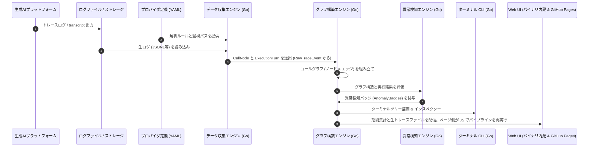

# AgentLens: システムアーキテクチャ設計書 (System Architecture)

> **言語切り替え**: [English](../en/ARCHITECTURE.md) | [日本語](ARCHITECTURE.md)

---

## 1. システム全体図

AgentLens は、生成AIの生実行トレースを解析し、異常検知・注釈付きのコールグラフを構築します。特定の生成AI製品への依存を宣言的**プロバイダ定義 (Provider Definition)** に完全に局所化し、**Go言語による単一バイナリ配布** と **GitHub Pages 無料Web UI** を組み合わせることで、ユーザーの環境依存トラブルを根絶します。



---

## 2. ディレクトリ構成とモジュール設計

```text
agentlens/
├── .github/
│   ├── workflows/
│   │   ├── ci.yml                 # go test / go vet / build と E2E スイート
│   │   └── deploy-pages.yml       # web/ をそのまま GitHub Pages に公開
│   ├── ISSUE_TEMPLATE/
│   └── pull_request_template.md
├── cmd/agentlens/main.go          # CLI エントリーポイント（標準ライブラリのみ）
├── docs/{en,ja}/                  # ARCHITECTURE, CONTRIBUTING, ROADMAP, SPECIFICATION
├── examples/
│   ├── providers/                 # 組み込みプロバイダ定義（バイナリに埋め込み）
│   │   ├── antigravity.yaml
│   │   ├── claude_code.yaml
│   │   ├── cursor.yaml
│   │   ├── generic_jsonl.yaml
│   │   └── embed.go
│   └── traces/                    # ドキュメント・テスト・UI で使うサンプルセッション
├── internal/
│   ├── ansi/                      # 端末の色（パイプ時や NO_COLOR 設定時は無効）
│   ├── cli/                       # コマンド (app.go)、ターミナル描画、report コマンド
│   ├── collector/                 # セッション探索、プロバイダ判定、組み立て、子トレース
│   ├── detector/                  # 認証切れ・フォールバック・リトライループ検知、代替サービス対応表
│   ├── graph/                     # グラフ構築、依存関係、メトリクス
│   ├── models/                    # コアデータモデル（ノード、エッジ、異常、プロバイダ設定）
│   ├── providers/                 # プロバイダ YAML の読み込み、フィールド式、スコープ追跡
│   ├── report/                    # `report` と `/api/report` が共有する期間集計
│   ├── server/                    # ローカル HTTP API。static/index.html が内蔵 UI
│   ├── textutil/                  # 省略・整形のヘルパー
│   └── watcher/                   # `agentlens watch`: ポーリングによるライブ tail
├── rules/substitutes.yaml         # 公開サービスと、それを代替する CLI / ホスト
├── schemas/provider_definition.schema.json
├── tests/e2e/                     # Web UI の Puppeteer リグレッションテスト
├── web/index.html                 # Web UI（単一ファイル、ビルド工程なし）
├── go.mod
├── README.md
└── README.ja.md
```

---

```

---

## 3. コアデータモデル (`internal/models`)

### 3.1 `CallNodeType` (ノード種別)
```go
type CallNodeType string

const (
    NodeTypeUserTurn   CallNodeType = "user_turn"
    NodeTypeAgent      CallNodeType = "agent"
    NodeTypeSubagent   CallNodeType = "subagent"
    NodeTypeSkill      CallNodeType = "skill"
    NodeTypeMCPTool    CallNodeType = "mcp_tool"
    NodeTypeSystemTool CallNodeType = "system_tool"
)
```

### 3.2 `CallNode` (ノード定義)
```go
type CallNode struct {
    ID           string                 `json:"id"`
    SessionID    string                 `json:"session_id"`
    ParentID     string                 `json:"parent_id,omitempty"`
    TurnIndex    int                    `json:"turn_index"`
    CallerScope  string                 `json:"caller_scope,omitempty"` // "Agent", "Skill: <name>", "Subagent: <name>"
    ScopeName    string                 `json:"scope_name,omitempty"`   // Scope this call opens, e.g. "Skill: <name>"
    Type         CallNodeType           `json:"type"`
    Name         string                 `json:"name"`
    MCPServer    string                 `json:"mcp_server,omitempty"`
    Timestamp    time.Time              `json:"timestamp"`
    DurationMs   int64                  `json:"duration_ms,omitempty"`
    Status       CallStatus             `json:"status"` // "success", "failed", "timeout", "denied", "unknown"
    Arguments    map[string]interface{} `json:"arguments,omitempty"`
    Output       interface{}            `json:"output,omitempty"`
    ErrorMessage string                 `json:"error_message,omitempty"`
    Anomalies    []AnomalyRecord        `json:"anomalies,omitempty"`
    ParentLink   ParentLink             `json:"parent_link,omitempty"` // "sidecar", "result", "inferred"
    Auxiliary    bool                   `json:"auxiliary,omitempty"`
    Synthetic    bool                   `json:"synthetic,omitempty"`   // ビルダーが構造のために追加するターン・スコープのノード
}}
```

`Status` が `denied` の呼び出しは、ユーザーや権限設定に拒否されて実行されなかったもの (`results.denied_regex`) で、失敗とは区別します。`Auxiliary` はツール検索・タスク管理・計画などエージェント自身の管理操作 (`extraction.auxiliary_tools`) を表します。denied と補助ツールの呼び出しはフォールバックとリトライループの判定に関与しません。「MCP 失敗 → ツール検索 → シェル」は、MCP からシェルへのフォールバックとして扱います。

`Synthetic` はグラフビルダーが構造のために追加するターン・スコープのノードを表します。呼び出しではないので、検知や呼び出し数の集計には関与しません。

ターンは `turns.filter` に一致するメッセージで始まり、ユーザーが書いた最初の行をラベルにします（ハーネスが差し込む `<tag>…</tag>` ブロックは飛ばし、そうしたブロックだけのメッセージは `[tag] 先頭行` とラベル付けします）。ユーザーロールでもユーザーが書いていないメッセージは、このラベルに対する `turns.skip_regex` で除外します。スラッシュコマンドや `!` シェルコマンドの出力、応答を中断したときのマーカーがこれにあたり、それらに続く呼び出しは現在のターンに残ります。

サイレントフォールバックは、失敗 (またはタイムアウト) した MCP / Skill 呼び出しの直後にシステムツール (シェル、HTTP 取得、ファイル操作) が続いたときに、プロバイダを問わず報告します。後続の呼び出しは失敗が判明した後に始まっている必要があります。1回のモデル応答で同時に発行された呼び出しはタイムスタンプを共有し、互いのフォールバックにはなりません。`anomaly_rules.known_fallbacks` にはプロバイダ固有の組み合わせだけを書きます。各検知には `confidence` が付きます。

- `high`: 代わりの呼び出しが同じ公開サービスに到達している (プロバイダ共通の対応表 `rules/substitutes.yaml` にある CLI を実行した、またはホストを呼んだ。例: GitHub → `gh`)、または失敗した呼び出しの固有名詞 (リポジトリ名、テーブル名、ID など) を2つ以上使っている。
- `low`: 呼び出しの順序だけが根拠。「Possible Silent Fallback」として表示し、確定した検知ではなく確認すべき手がかりとして扱います。

対応表には広く使われている公開サービスだけを載せます。組織固有のツールは載せず、そのフォールバックは固有名詞の一致で判定します。

`ParentLink` は子 (サブエージェント) トレースから統合した呼び出しに設定され、その配置の根拠を表します。

| 値 | 根拠 | 確からしさ |
| :--- | :--- | :--- |
| `sidecar` | 子のメタデータに起動元の呼び出しが記録されている (`child_traces.parent_call_id_field`)。 | 記録あり |
| `result` | 起動元の呼び出しのツール結果に子の ID が記録されている (`child_traces.result_child_id_field`)。例: Skill から fork されたサブエージェント。 | 記録あり |
| `inferred` | 子と呼び出しを結ぶ記録がない。子の呼び出しは、子の開始時点で進行中だったターンに置いたプレースホルダーのサブエージェントノード (`id: inferred-subagent-<子>`、`parent_id` は空) の下に配置し、依存関係の行にも `inferred: true` を付ける。 | 推定 |

### 3.3 `CallEdge` (エッジ定義)
```go
type CallEdgeType string

const (
    EdgeTypeCalls      CallEdgeType = "calls"
    EdgeTypeSpawns     CallEdgeType = "spawns"
    EdgeTypeFallbackTo CallEdgeType = "fallback_to"
    EdgeTypeRetries    CallEdgeType = "retries"
)

type CallEdge struct {
    SourceID string       `json:"source_id"`
    TargetID string       `json:"target_id"`
    Type     CallEdgeType `json:"type"`
}
```

### 3.4 `AnomalyRecord` (異常検知レコード)
```go
type AnomalyType string

const (
    AnomalySilentFallback AnomalyType = "silent_fallback"
    AnomalyAuthExpired    AnomalyType = "auth_expired"
    AnomalyRetryLoop      AnomalyType = "retry_loop"
)

type AnomalyRecord struct {
    ID             string      `json:"id"`
    Type           AnomalyType `json:"type"`
    Severity       string      `json:"severity"` // "info", "warning", "critical"
    NodeID         string      `json:"node_id"`
    RelatedNodeID  string      `json:"related_node_id,omitempty"`
    Title          string      `json:"title"`
    Description    string      `json:"description"`
    Recommendation string      `json:"recommendation,omitempty"`
    Confidence     Confidence  `json:"confidence,omitempty"` // silent fallbacks: "high" or "low"
    Evidence       string      `json:"evidence,omitempty"`   // what the confidence rests on
}}
```

---

## 4. Web UI の二重配信設計 (Dual-Hosting Architecture)

AgentLens の Web UI は、手書きの1ページ `web/index.html` で、ビルド工程はありません:
1. **GitHub Pages による無料ホスティング**:
   - `.github/workflows/deploy-pages.yml` が `web/` をそのまま `https://tsbkw.github.io/agentlens` に公開します。
   - **完全クライアントサイド実行（高セキュリティ）**: ユーザーがトレースファイル（`transcript.jsonl` 等）をブラウザへドラッグ＆ドロップすると、JavaScriptがすべてローカルで解析・描画します。外部サーバーへの通信は一切行われません。
2. **Goバイナリへの内蔵 (`//go:embed`)**:
   - `internal/server/static/index.html` は `web/index.html` のコピーで、`//go:embed static/index.html` によりバイナリに同梱されます。両者が異なると `TestEmbeddedUIMatchesPagesUI` が失敗するため、UI を変更したらコミット前にコピーします。
   - `agentlens ui` を実行すると、`127.0.0.1:8000` でローカルHTTPサーバーが立ち上がり、同一のダッシュボードを配信します。あわせて、画面のローカルセッション一覧に期間集計とセッションの生ファイルを提供します。
