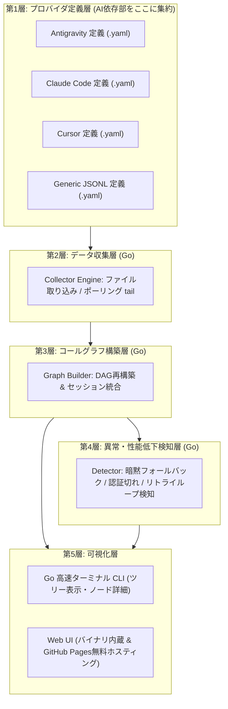

# AgentLens: 機能仕様書 (Functional Specification)

> **言語切り替え**: [English](../en/SPECIFICATION.md) | [日本語](SPECIFICATION.md)

---

## 1. 概要と課題意識 (Overview & Problem Statement)

### 1.1 解決する課題
自律実行モード（auto mode）で動作する現代の生成AIシステムは、**SKILL**、**MCP (Model Context Protocol) サーバー**、サブエージェント、内部ツールなどを動的に組み合わせて多段階のタスクを実行します。

しかし、実行の裏側で「実際に何がどのように呼び出されているのか」は極めて不透明になりがちです:
- **暗黙的な性能低下とフォールバック (Silent Degradation & Fallbacks)**:
  外部MCPの認証（OAuthやAPIキー等）が期限切れになった場合やSKILLでエラーが発生した際、AIはユーザーに通知することなく別の手段を勝手に試すことがあります。例えば、本来直接呼び出すはずの外部MCPツール（例: `github_mcp.create_issue`）が認証切れで失敗した結果、暗黙的にシェルコマンド（`gh issue create` や `curl`）や別の二次ツール経由でアクセスしようとし、コンテキストが抜け落ちたり、機能が制限されたり、低品質な結果に終わることが頻発します。
- **意図せぬ非効率のブラックボックス化**:
  ユーザーは、AIが意図通りの専門ツールを呼び出したのか、失敗を繰り返して無駄なターンを消費したのか、あるいは不十分な迂回ルートを取ったのかを事後的に把握することが困難です。
- **マルチエージェントの呼び出し階層の複雑化**:
  サブエージェントが子プロセスとして起動された場合、どのエージェントがどのツールやMCPを共有・実行したのかを追跡することが難しくなります。

### 1.2 本ツールの目的
**AgentLens** は、生成AIとのやり取りで実行されたSKILLやMCP等のツール呼び出しを構造化し、**コールグラフ（有向非巡回グラフ: DAG）** として可視化するオブザーバビリティ（可観測性）ツールです。
実行履歴からコールグラフを再構築し、認証切れや暗黙的フォールバックなどの**異常・性能低下（Anomaly）を自動検知**し、**コマンドライン（CLI）** および **Web UI** の双方で分かりやすく提示します。

### 1.3 環境非依存性への設計指針
Pythonのバージョン不整合、仮想環境のコンフリクト、Node.js/npmの事前要求といった環境起因のトラブルを完全に排除します:
1. **Go言語による単一バイナリ配布**: ユーザーのPCに **Python も Node.js も不要** な単一実行ファイルとして提供。
2. **Web UI のバイナリ内蔵（embed）**: 事前ビルドされたWeb UIアセットをGoバイナリに同梱。`agentlens ui` 1発でオフラインでも即座にブラウザ起動。
3. **GitHub Pages による無料ホスティング**: 同じWeb UI（単一の `web/index.html`。ビルド工程なし）を `https://tsbkw.github.io/agentlens` に完全無料ホスティング。手元のログをブラウザにドラッグ＆ドロップするだけで、サーバー送信なしの完全ローカル処理で即座に可視化が可能。

---

## 2. コア設計思想 (Core Architectural Principles)

AgentLens は、将来にわたって特定のAIベンダーやモデルに縛られないよう、**5層の責任分離（5-Layer Separation of Concerns）** を徹底します:

### 設計原則: AIプロバイダ依存の完全分離
**生成AI製品ごとのログ形式やトレース取得方法に関する依存は、すべて「第1層（プロバイダ定義層）」に限定します。**
第2層〜第5層のコアロジックは、正規化された内部データモデル（`CallNode`, `CallEdge`, `ExecutionTurn`, `AnomalyRecord`。`graph.Graph` に組み立てられます）のみを相手に動作します。新しい生成AI（Cursor, Roo Code, LangChain等）に対応する際は、設定ファイル（YAML/JSON）を1つ追加・定義するだけで対応可能であり、コアエンジンの修正は不要です。

---

## 3. コンポーネント別詳細仕様 (Detailed Component Specifications)

### 3.1 第1層: プロバイダ定義層 (Provider Definition Layer)
[`provider_definition.schema.json`](../../schemas/provider_definition.schema.json) に準拠する宣言的YAML/JSONファイル。

- **データソース設定**: `source.type: file` と、glob パターンの一覧 `source.paths`（`~` はホームディレクトリに展開）。任意で `source.child_traces` にサブエージェントのトレースファイルとメタデータの場所を書けます。実装されているソースはファイルだけで、スキーマ上の他の名前（`command`, `otel_collector`）は将来のために予約されています。
- **抽出ルール**:
  - `session`: 会話・セッションIDの抽出パスや正規表現。
  - `events`: ツール呼び出しのフィルタ条件（1イベント1呼び出し、または1イベント内の呼び出しリスト）。
  - `fields`: タイムスタンプ、呼び出しID、呼び出し元、ツール名、MCPサーバー名、引数、戻り値、成否ステータス、所要時間のマッピング。
  - `results`: ツール結果を呼び出しに対応付ける方法（呼び出しID、またはステップ順）。拒否を意味する結果の正規表現も含みます。
  - `scopes`: Skill / Subagent のスコープを開く呼び出し。以降の呼び出しはそのスコープに帰属します。
  - `auxiliary_tools`: ツール検索やタスク管理などの補助ツール。フォールバックとリトライの判定に関与しません。
- **異常検知ヒューリスティクス**: 認証切れを示す正規表現、既知のフォールバック対。

### 3.2 第2層: データ収集層 (Data Collector Layer in Go)
- 有効なプロバイダ定義に従って生イベントを収集。
- **過去ログ解析（バッチ）** と **ライブ監視**（`agentlens watch` がトレースファイルとサブエージェントのファイルを 500 ms ごとにポーリング）の双方に対応。
- 生ログを共通の `RawTraceEvent` へ正規化。

### 3.3 第3層: コールグラフ構築層 (Call Graph Assembler Layer in Go)
- 正規化されたイベント列から、有向非巡回グラフ（DAG）を組み立て。
- **ノード種別** (`CallNodeType`):
  - `user_turn`: ユーザーの指示・プロンプト単位。
  - `agent`: メインエージェント。
  - `subagent`: 起動されたサブエージェント。
  - `skill`: 高レベルなSKILL呼び出し。
  - `mcp_tool`: 外部MCPサーバーが提供するツールの呼び出し（`mcp_server` 属性付き）。
  - `system_tool`: 組み込みツール（シェルコマンド、ファイル操作等）。
- **エッジ種別** (`CallEdgeType`):
  - `calls`: 直接の親子呼び出し。
  - `spawns`: サブエージェントの起動。
  - `fallback_to`: ツール失敗からの代替ツールへの暗黙的移行。
  - `retries`: 同一ツールの再試行。
- メトリクス (`GraphMetrics`) を算出: 種別ごとのノード数・エッジ数、失敗数・拒否数、呼び出しの最大深さ、ツール呼び出しの所要時間の合計。トークン消費量は記録しません。

### 3.4 第4層: 異常・性能低下検知層 (Anomaly & Degradation Detector in Go)
AIの意図せぬ動作や性能劣化をルール・ヒューリスティクスに基づいて自動検出:
1. **暗黙的フォールバック検知 (Silent Fallback)**:
   本来実行されるべきツール（例: MCPツール）が失敗または認証エラーを起こし、直後に同一目的と推定される別ツール（例: シェルや代替ツール）を実行した遷移を検知。
2. **認証切れ検知 (Auth Expiration)**:
   HTTP 401, 403, "token expired", OAuth再認証失敗などのエラーメッセージや戻り値を検知。
3. **リトライループ・スタック検知 (Retry Loops)**:
   同じ実行主体による同一ツールの3回以上の連続失敗を検出。連続失敗ごとに1件報告。

各サイレントフォールバックには `confidence` が付きます（代わりの呼び出しが同じ公開サービスに到達している、または失敗した呼び出しの固有名詞を使っているなら `high`、呼び出しの順序だけが根拠なら `low`。詳細は ARCHITECTURE）。迂回ルーティングとレイテンシ異常の検知は計画中（ROADMAP）で、未実装です。

### 3.5 第5層: 可視化層 (Visualizer Layer)

#### 3.5.1 コマンドラインツール (`agentlens` CLI)
- **`agentlens list`**: 記録されたセッション一覧および検出されたプロバイダの表示。
- **`agentlens graph <session-id | file>`**: 呼出元 ➔ 呼出先のコールグラフをターミナルに描画（成功=緑、エラー=赤、フォールバック警告=黄）。サマリー行と異常の一覧付き。
- **`agentlens trace <session-id | file>`**: ターン単位の実行ツリーを、ステータス・所要時間・異常バッジ付きで描画。
- **`agentlens inspect <call-id> [session-id]`**: 特定ノードの引数・出力・異常検知結果の詳細表示。セッションを省略すると全セッションを探索。
- **`agentlens watch [session-id]`**: 実行中のセッション（省略時は最新）とそのサブエージェントをターミナルでリアルタイム監視。
- **`agentlens report`**: 期間内の全セッションの呼び出しと検知結果を集計 (`--since`, `--until`, `--project`, `--top`, `--json`)。MCP サーバー・ツール・セッションごとに検知の多い順で一覧。さらに Skill と MCP サーバーをセッション横断で追跡し (`tool_health`)、**休眠**しているもの（最後に使ったときに動いていないもの）を理由付きで一覧します。理由はサーバー接続失敗、サインイン待ち、認証失敗が未解消、拒否、代替ツールへの置き換え、失敗のいずれかで、沈黙期間と最後のエラーも示します。提供されていたのに一度も呼ばれなかった Skill・サーバーは別枠で名前を挙げます。
- **`agentlens why <名前>`**: Skill や MCP サーバーが使われていない理由を説明します (`--since` 既定 30 日, `--until`, `--project`, `--json`, `--prompt`)。期間内の各セッションでの結果（提供されたか、接続失敗、サインイン待ち、呼び出しの成功・失敗・拒否数、何にフォールバックしたか）、同じ公開サービスに別の手段で到達したツール、根拠付きの診断（上記の休眠理由に加え、*代替ツールが選ばれている*、*必要な作業がなかった*、*正常*、*見つからない*）、推奨対応、そして同じ端末上の Claude Code に原因調査（設定、認証情報、権限、説明文）を依頼する貼り付け用プロンプトを出します。プロンプトは秘密情報を出力しないよう指示します。同じ分析は `GET /api/why?tool=<名前>` でも取得できます。
- `--provider <id | file.yaml>` でトレース形式を指定（既定は自動判定）。色は `NO_COLOR` / `FORCE_COLOR` に従い、stdout が端末でなければ無効になります。

#### 3.5.2 Web UI ダッシュボード (内蔵 & GitHub Pages)
- **GitHub Pages 無料ホスティング**: `https://tsbkw.github.io/agentlens` にてホスティング。手元のログをドラッグ＆ドロップするだけで、サーバー通信不要の安全な完全ローカル描画。
- **ローカル内蔵サーバー**: `agentlens ui`（`--port <n>`、既定 8000）でGo内蔵のWebサーバーが `http://localhost:8000` で立ち上がり、オフラインでも利用可能。画面ではドラッグ＆ドロップに加えて、ローカルセッションのダッシュボードを表示します。期間とプロジェクトで絞り込み、`agentlens report` と同じ集計（`GET /api/report`）を出し、セッションの生のトレースファイル（`GET /api/sessions/<id>/files`）からコールグラフを開きます。これらのファイルは、ドロップしたファイルと同じくブラウザ内で解析されます。ダッシュボードには期間内の休眠 Skill / MCP サーバーの一覧もあり、**Why?** ボタン（各 MCP サーバー行にもあります）で `agentlens why` の分析をパネルに開きます。診断、根拠、直近セッション（クリックで開ける）、代替ツール、推奨対応、そしてコピーボタン付きの Claude Code 向けプロンプトを表示します。API がセッションの会話ログ全体を返すため、サーバーは `127.0.0.1` だけで待ち受け、`Host` ヘッダーが `localhost` またはループバック IP でないリクエストは拒否します。別の `agentlens ui` がポートを使っている状態で起動すると、その旧インスタンスを停止してポートを引き継ぎます。新しいプロセスは `GET /api/instance` が `"app": "agentlens"` を返すことを確認し、`X-Agentlens-Shutdown` ヘッダー付きの `POST /api/shutdown`（独自ヘッダーなので Web ページからは送れません）を送り、ポートが空くのを待ってから待ち受けます。agentlens 以外のプログラムが使っているポートには触れず、コマンドは失敗します。
- **Caller ➔ Callee Graph**: 呼出元（エージェント、Skill、Subagent のスコープ）ごとのカードに、各呼出先の呼び出し数・成功数・失敗数、入れ子のスコープ、失敗した呼び出しが置き換えられた場合のフォールバック行を表示。
- **Turn Execution Trace**: ユーザーのターンごとに呼び出しを順に表示。ステータス、種別、MCP サーバー、所要時間、異常バッジ付き。
- **異常値警告バナー & インスペクター**: 検出された暗黙フォールバックや認証エラーと推奨アクションのカード、ノードの引数・出力・異常を表示するドロワー。失敗を含むツール行をクリックした際は自動的に失敗した呼び出しが優先表示され、ドロワー内の呼び出しスイッチャーで複数回の試行を1クリックで切り替え可能です。スイッチャー内でもステータスや種別（Type）による絞り込みが可能です。
- **失敗要因の自動診断と推奨アクション (Failure Diagnosis & Actionable Fixes)**: フレームワーク特有のラップ文字列を除去して真の根本原因（Root Cause）を抽出し、主要な運用障害カテゴリ（File Not Found `📁`, Command Exit Error `💻`, Command Not Found `🚫`, Task State Conflict `⚙️`, Auth Expired `🔒`, Execution Timeout `⏱️`, Rate Limit `⏳`, Permission Denied `🛑`, Network Connection Error `🔌`, Tool Call Denied `⊘`, Invalid Arguments `⚠️`）へ自動分類。ドロワー内に専用の診断カードを表示し、クリーンな根本原因と具体的な対処法（Recommended Fix）を提示します。また、コールグラフ行やトレース行にもひと目で原因がわかるインラインバッジが表示されます。
- **セッション単位の改善提案バナー (Session-Level Recommendations)**: 閲覧中のセッションで発生した全失敗をカテゴリ・ツール別に集計し、具体的な解決アクションと該当エラーへ一発ジャンプする「🔍 View in Trace」ボタンを備えた推奨カードを画面上部に表示します。
- **ディープリンクとブラウザ履歴ナビゲーション (History API)**: ブラウザの「戻る」「進む」ナビゲーション（`popstate`）に完全対応し、「戻る」でドロワーを閉じる、またはセッション一覧へ戻る操作が可能です。現在のセッションや選択呼び出しは一意で共有可能なURL（`?session=<id>&call=<call_id>`）に反映されます。
- **クライアントサイド・プライバシーの明示**: 「Client-Side Privacy」バッジと詳細ツールチップを備え、トレース解析・グラフ構築・異常検知の100%がローカルのブラウザサンドボックス内で完結し、外部サーバーへのログ送信が一切行われないことを明示します。
- **検索・フィルタリング**: 呼出元・呼出先名のフリーテキスト検索と、種別（MCP / Skill / System Tool / Subagent）およびステータス（失敗 / 成功 / 拒否 / 異常）の各ドロップダウンによる絞り込み。ドロワー内の呼び出し一覧（Invocations）も同様にステータスと種別で絞り込めます。ヘッダーの統計カードをクリックすることでも即座にフィルタリング可能です。
- **ブラウザ内での解析**: ページは収集・グラフ構築・検知のロジックを JavaScript で再実行します。使うのは埋め込まれた組み込みプロバイダのルールです（`internal/server/webrules_test.go` が `examples/providers/*.yaml` との同期を保ちます）。独自の `--provider` YAML は CLI とサーバーの集計には効きますが、ブラウザの解析には適用されません。

ノード・エッジのキャンバス描画とタイムライン表示は計画中（ROADMAP）で、未実装です。

---

## 4. 多言語対応 (i18n) 方針
- **ソースコードおよびコメント**: 英語（`en`）で統一。
- **ドキュメント**: 英語（`docs/en/`）を正本とし、日本語（`docs/ja/`）を並行して保守。
- **ユーザーインターフェース (CLI / Web UI)**: 現在は英語のみ。日本語 UI（`--lang ja`、`AGENTLENS_LANG`）は ROADMAP Phase 8 で計画中で、未実装です。
